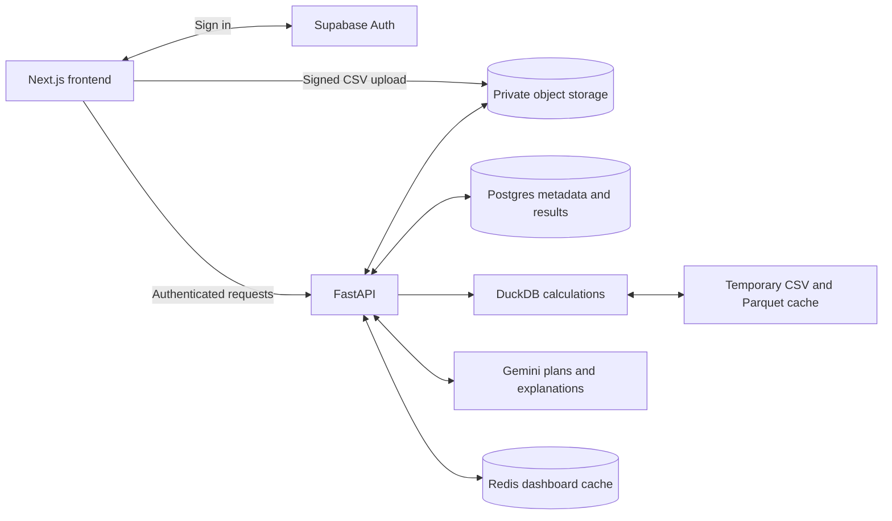

# Data analysis workspace

Upload CSV files, connect related tables, and ask questions about your data in plain language. The app can summarize results, create charts, flag statistical anomalies, and show the SQL and calculation method behind an answer.

[Open the live app](https://data-analyst-agent-livid.vercel.app)

[Sample Datasets](datasets)

## Screenshots


## How to use it

1. Create an account or sign in, then create an analysis.
2. Upload one or more CSV files. Arrange the tables on the canvas, connect columns to join related tables, or drop tables with matching columns onto each other to stack their rows.
3. Open **Data preview** to inspect a table, check data quality notes, or export its CSV.
4. In **Analysis**, choose a table or **All tables**, then ask a question. You can ask follow-up questions, inspect the generated SQL, and export the results.
5. In **Dashboard**, choose the tables to include and generate a summary with charts. You can also pin useful answers to the dashboard.

Use the canvas zoom controls to move around larger layouts. Each table has options to rename it and preview its rows. Saved analyses can be reopened from the workspace.

Example questions:

- Which region generated the highest revenue?
- Show monthly sales trends as a line chart.
- Which products have revenue below the average product revenue?
- Who are the top five customers by revenue?
- Detect unusual values and explain the threshold used.

CSV files must use UTF-8 with unique, non-empty column names. An analysis supports up to five source files, 15 MB combined, and 20,000 source rows. Each table can have up to 40 columns; joined and stacked outputs also have a 15 MB and 20,000-row limit. Stacking requires matching column names and compatible types. Joins support an inner or left join on one pair of columns.

## Architecture



- **Next.js** provides the workspace, table canvas, charts, and question interface.
- **FastAPI** validates files, prepares joined and stacked tables, runs analysis, and handles exports.
- **Supabase Auth, Postgres, and Storage** handle accounts, saved analyses and results, and private CSV files.
- **DuckDB** runs calculations over the uploaded data, using temporary Parquet copies for querying.
- **Gemini** generates SQL from table metadata and conversation context, then explains the calculated results. The backend validates SQL before execution. Full CSV files are not sent to Gemini; prompts contain compact metadata, short samples, and limited result rows.
- **Redis** caches saved dashboards so reopening them does not require another model call.

Calculation runs inside the backend. Answers include the method and assumptions, and anomaly explanations describe the statistical threshold used. Bar, line, pie, and scatter charts are rendered from the calculated results.

## Set up locally

You need Docker with Compose and Python 3.12 or newer. Start Docker and run these commands from the repository root.

### 1. Create the local configuration

```bash
python3 scripts/local_setup.py
```

This creates a private root `.env` with local database and authentication credentials. It keeps an existing `.env` unchanged. No cloud Supabase account is needed.

Add your Gemini API key to that file:

```dotenv
GEMINI_API_KEY=your-key
GEMINI_MODEL=gemini-2.5-flash
```

Questions and dashboard generation need a valid Gemini key and internet access. Uploads, table preparation, previews, and CSV exports work without the key.

### 2. Start the application

```bash
docker compose up --build -d --wait
```

Open [http://127.0.0.1:3000](http://127.0.0.1:3000). Create an account or sign in. Email confirmation is disabled locally.

| Service | Local address |
| --- | --- |
| Frontend | http://127.0.0.1:3000 |
| Backend | http://127.0.0.1:4000 |
| API documentation | http://127.0.0.1:4000/docs |
| Auth and storage gateway | http://127.0.0.1:54321 |
| Postgres | 127.0.0.1:54322 |
| Redis | 127.0.0.1:6379 |

### 3. Stop or restart

```bash
docker compose down
```

Docker volumes preserve accounts and files. Keep the generated `.env`, since its password matches the initialized database. Changing that password alone does not update an existing database.

After changing the Gemini key, recreate the backend to load it:

```bash
docker compose up -d --force-recreate backend
```

After changing application code, run `docker compose up --build -d --wait` again.

### Local development and checks

To run the frontend and backend outside Docker, install Node.js 22+ and [uv](https://docs.astral.sh/uv/getting-started/installation/). Complete the configuration step above, then run:

```bash
npm ci
uv sync --directory backend --frozen
docker compose up -d --wait redis db auth rest storage gateway
npm run dev
```

If the app containers are running, stop them first with `docker compose stop frontend backend` to free ports 3000 and 4000.

With the local infrastructure running, use these checks:

```bash
npm run typecheck
npm run lint
npm test
npm run lint:backend
npm run test:backend
npm run evaluate
npm run build
```

Integration tests use the local services and a test model. The default evaluation checks known DuckDB results without calling Gemini.
